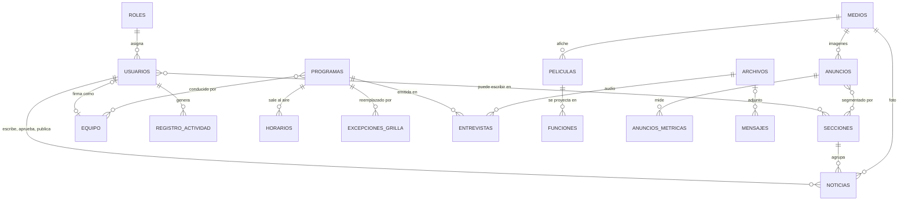

# Esquema del backend · Visión 96.5 FM

Colecciones y fichas globales de Payload sobre PostgreSQL. Payload genera las tablas y las migraciones a partir de esta configuración; los nombres de campo son los que irán en el código.

**Convenciones**
- Todas las colecciones tienen `id`, `createdAt` y `updatedAt` (los agrega Payload).
- `slug`: se genera del título, único, solo `a-z 0-9 -` (tildes y ñ se normalizan), editable.
- Fechas en UTC en la base; el panel y el sitio muestran hora de `America/Montevideo`.
- `*` = obligatorio. `✎` = con borradores y versiones.
- Imágenes y archivos: relación a `medios` o `archivos`, guardados en Cloudflare R2.

**Permisos:** roles editables con permisos por área y acción, más ajustes por usuario y delegación. El modelo completo está en `07-permisos-y-publicidad.md`; donde abajo dice "Acceso", se refiere a los roles de fábrica.

---

## usuarios (auth)

| Campo | Tipo | Notas |
|---|---|---|
| `nombre`* | texto | |
| `email`* | email | único, login |
| `rol`* | relación → `roles` | Owner, Administrador, Manager, Editor, Periodista, Colaborador, Cinevisión, Comercial o uno creado |
| `ajustesPermisos` | JSON | permisos que suman o quitan sobre el rol (área × acción). En la etapa 1 solo se usa Noticias → Publicar |
| `seccionesPermitidas` | relación múltiple → `secciones` | vacío = todas |
| `activo`* | checkbox | desactivar cierra sesiones y quita el acceso en Cloudflare Access |
| `esOwner` | checkbox | solo uno; no editable desde el panel salvo por transferencia |
| `equipo` | relación → `equipo` | para firmar notas con la ficha pública |
| `recibeAvisosRevision` | checkbox | solo para quien tiene Noticias → Aprobar; recibe avisos de notas para revisar |
| `avisosEmail` | select | al-instante · resumen-por-hora · nunca (por defecto, al instante) |

Acceso: Owner y Administrador (Sistema) invitan, editan y desactivan usuarios; Owner, Administrador, Manager y Editor pueden dar o quitar Noticias → Publicar a periodistas y colaboradores. Los usuarios no se borran, se desactivan, para que el registro conserve el autor. Cada usuario edita su nombre y contraseña. Bloqueo tras 5 intentos fallidos por 10 min.

## roles

| Campo | Tipo | Notas |
|---|---|---|
| `nombre`* | texto | único |
| `permisos`* | JSON | por área (radio, noticias, cinevision, institucional, publicidad, sistema) y acción (ver, crear, editarPropio, editarTodo, publicar, aprobar, borrar) |
| `deFabrica` | checkbox | los de fábrica se pueden editar pero no borrar |

En la etapa 1 los 8 roles de fábrica están fijos en código y esta colección solo se lee; en la etapa 2 se editan desde la grilla del panel.

## registroActividad

Solo lectura para todos, incluido el Owner. Lo escribe un hook global `afterChange` / `afterDelete` en todas las colecciones y fichas, más los eventos de login. Registra crear, editar, cambios de estado editorial, publicar, despublicar, borrar, restaurar versión, altas, bajas, cambios de permisos, ingresos e intentos fallidos. Se conserva 2 años y después se archiva en R2.

| Campo | Tipo |
|---|---|
| `quien`* | relación → `usuarios` |
| `accion`* | texto |
| `objetivo` | texto (colección, id y título) |
| `campos` | texto múltiple (campos cambiados) |
| `antes` / `despues` | JSON (solo campos cambiados) |
| `ip` / `dispositivo` | texto |
| `fecha`* | fecha y hora |

Índices: `(quien, fecha)`, `(objetivo, fecha)`, `fecha`.

## medios (upload)

| Campo | Tipo | Notas |
|---|---|---|
| archivo* | imagen | JPG, PNG, WebP, AVIF; máx. 15 MB; se generan tamaños 320, 640, 960, 1280, 1920 en WebP y AVIF |
| `alt`* | texto | texto alternativo, máx. 160 caracteres |
| `credito` | texto | fotógrafo o fuente |

Acceso: lectura pública; crea cualquier usuario con Crear en alguna área; borra quien tiene Borrar en Noticias o Sistema.

## archivos (upload)

Audios de entrevistas, adjuntos y PDF. Separado de `medios` para no generar tamaños de imagen.

| Campo | Tipo | Notas |
|---|---|---|
| archivo* | archivo | MP3, M4A, PDF, DOC/DOCX, MP4; máx. según uso |
| `privado` | checkbox | adjuntos de formularios: no públicos, se descargan con URL firmada |

## secciones

| Campo | Tipo | Notas |
|---|---|---|
| `nombre`* | texto | Locales, Nacionales, Policiales, Deportes, Cultura, Opinión |
| `slug`* | slug | único; reservado contra slugs de notas |
| `descripcion` | textarea | meta description de la sección |
| `orden`* | número | orden en la tira y el menú |

Acceso: área Noticias (Editar todo).

## noticias ✎

| Campo | Tipo | Notas |
|---|---|---|
| `titulo`* | texto | máx. 120 |
| `slug`* | slug | único dentro de la sección |
| `bajada`* | textarea | 80–280 caracteres |
| `cuerpo`* | rich text (Lexical) | párrafos, subtítulos H2/H3, citas, listas, links, imágenes, embeds de YouTube |
| `foto`* | relación → `medios` | |
| `epigrafe` | texto | |
| `seccion`* | relación → `secciones` | |
| `autor`* | relación → `usuarios` | por defecto, quien crea |
| `fechaPublicacion`* | fecha y hora | por defecto, al publicar; si es futura, la nota se programa |
| `fechaActualizacion` | fecha y hora | se completa al corregir una nota publicada; se muestra "Actualizado …" |
| `estadoEditorial`* | select | borrador · en-revision · devuelta · aprobada · publicada (ver flujo P2) |
| `comentarioEditor` | textarea | motivo al devolver una nota; visible para el autor |
| `aprobadoPor` | relación → `usuarios` | se completa al aprobar |
| `publicadoPor` | relación → `usuarios` | se completa al publicar |
| `destacada` | checkbox | candidata a destacada en Noticias |
| `seo` | grupo | `titulo`, `descripcion`, `imagen` (opcionales; caen a título, bajada y foto) |

Índices: `(seccion, fechaPublicacion desc)`, `estadoEditorial`, `slug`, búsqueda de texto completo en español con `unaccent` sobre `titulo + bajada + cuerpo`.
Acceso: área Noticias, limitada a `seccionesPermitidas`. Con Crear y Editar lo propio se cargan y editan las propias; con Publicar se publica o programa, si no, se envía a revisión; con Aprobar se aprueba o devuelve; con Editar todo se editan las de otros.
Regla en el servidor (hook `beforeChange`): un periodista sin permiso no puede guardar `_status: published` ni `estadoEditorial: publicada|aprobada`; si edita una nota publicada, su cambio queda como borrador pendiente y la versión publicada sigue en línea hasta que un editor apruebe.
Avisos: dentro del panel, el inicio y el menú muestran contadores calculados en vivo (notas `en-revision` para editores, `devuelta` para el autor, mensajes `nuevo`); no hace falta una tabla de notificaciones. Por email, según `avisosEmail` de cada usuario: al pasar a `en-revision` → editores con `recibeAvisosRevision`; al pasar a `devuelta` o `publicada` → el autor.
Hooks: al publicar o cambiar → revalidar nota, sección, `/noticias`, `/`, RSS y purgar Cloudflare. Si cambia sección o slug → crear redirección 301.

## entrevistas ✎

| Campo | Tipo | Notas |
|---|---|---|
| `entrevistado`* | texto | |
| `tema`* | texto | |
| `slug`* | slug | |
| `programa`* | relación → `programas` | |
| `fecha`* | fecha | |
| `audio`* | relación → `archivos` | MP3/M4A, máx. 90 MB (límite de subida de Cloudflare: 100 MB) |
| `duracion` | número (segundos) | se calcula del archivo |
| `foto` | relación → `medios` | |
| `resumen` | textarea | para SEO y buscador |
| `destacada` | checkbox | |

Índices: `fecha desc`, `programa`, búsqueda de texto sobre `entrevistado + tema + resumen`.
Acceso: área Radio (Periodista y Editor pueden crear).

## programas

| Campo | Tipo | Notas |
|---|---|---|
| `nombre`* | texto | |
| `slug`* | slug | |
| `descripcion` | textarea | |
| `conductores` | relación múltiple → `equipo` | |
| `foto` | relación → `medios` | |
| `horarios`* | array | cada fila: `dias`* (multiselect lun–dom), `inicio`* (HH:MM), `fin`* (HH:MM) |
| `activo` | checkbox | por defecto sí |

Validación: el panel avisa si dos programas activos se superponen en día y horario. Un horario que cruza la medianoche se carga como dos filas.
Acceso: área Radio.
API pública: `GET /api/grilla` devuelve la grilla semanal compacta (pocos KB) para calcular "Al aire" y "A continuación" en el navegador; se cachea en Cloudflare y se purga al guardar.

## excepcionesGrilla

Partidos, feriados o coberturas especiales que reemplazan la grilla habitual.

| Campo | Tipo | Notas |
|---|---|---|
| `fecha`* | fecha | |
| `inicio`* / `fin`* | hora | |
| `programa` | relación → `programas` | o bien `titulo` |
| `titulo` | texto | ej. "Fútbol: Laureles vs. Anglo" |
| `conduccion` | texto | |

Acceso: área Radio. `/api/grilla` incluye las excepciones de los próximos 7 días y el cálculo de "Al aire" las aplica antes que la grilla.

## equipo

| Campo | Tipo | Notas |
|---|---|---|
| `nombre`* | texto | |
| `rol`* | texto | ej. "Producción y conducción" |
| `grupo`* | select | direccion · produccion-general · conduccion · columnistas · tecnico |
| `foto` | relación → `medios` | |
| `bio` | textarea | |
| `redes` | array | `red` (select), `url` |
| `orden`* | número | orden dentro del grupo |

Acceso: área Radio.

## peliculas ✎

| Campo | Tipo | Notas |
|---|---|---|
| `titulo`* | texto | |
| `slug`* | slug | |
| `tituloOriginal` | texto | |
| `anio` | número | |
| `genero`* | texto | |
| `duracion`* | número (minutos) | |
| `calificacion`* | select | ATP · +7 · +13 · +16 · +18 |
| `idiomas`* | multiselect | subtitulada · doblada |
| `formatos`* | multiselect | 2D · 3D |
| `sinopsis`* | textarea | la versión corta sale de los primeros 280 caracteres |
| `afiche`* | relación → `medios` | proporción 2:3 |
| `trailer` | URL | YouTube; se guarda el ID |
| `creditos` | grupo | `direccion`, `reparto`, `guion`, `pais`, `idiomaOriginal`, `distribuidora` |
| `esEstreno` | checkbox | etiqueta "Estreno" |
| `fechaEstreno` | fecha | si es futura, va a "Próximos estrenos" |

Acceso: área Cinevisión.

## funciones

| Campo | Tipo | Notas |
|---|---|---|
| `pelicula`* | relación → `peliculas` | |
| `fechaHora`* | fecha y hora | |
| `idioma`* | select | subtitulada · doblada (limitado a los idiomas de la película) |
| `formato`* | select | 2D · 3D (limitado a los formatos de la película) |

Índices: `(fechaHora)`, `(pelicula, fechaHora)`.
Las funciones con `fechaHora` pasada no se consultan en el sitio. Se conservan 90 días y después se borran solas.
Acceso: área Cinevisión. Vista de panel propia: grilla semanal con "Copiar semana anterior".

## anuncios

| Campo | Tipo | Notas |
|---|---|---|
| `nombre`* | texto | interno |
| `anunciante`* | texto | agrupa los anuncios de un mismo cliente para el reporte |
| `emailReporte` | email | si se completa, recibe el reporte mensual |
| `imagenWeb`* | relación → `medios` | 970×90 exacto |
| `imagenMovil`* | relación → `medios` | 320×100 exacto |
| `link` | URL | |
| `ubicaciones`* | multiselect | inicio · radio-en-vivo · radio-programacion · radio-entrevistas · noticias-listado · noticias-seccion · noticias-nota · institucional · institucional-formularios |
| `secciones` | relación múltiple → `secciones` | limita Sección y Nota a esas secciones; vacío = todas |
| `desde`* / `hasta`* | fecha | vigencia |
| `peso` | número | 1 por defecto; peso relativo en la rotación de cada ubicación |
| `activo` | checkbox | |
| `impresiones` / `clics` | número | totales, solo lectura |

Las métricas por ubicación y por día van en una tabla aparte (`anunciosMetricas`: anuncio, ubicación, fecha, impresiones, clics) para poder exportarlas a CSV. Si una ubicación no tiene anuncios vigentes, se muestra el aviso propio de la radio configurado en `ajustes`.

Acceso: área Publicidad. El sitio pide los anuncios vigentes; rotan en el navegador. Una tarea diaria avisa 7 días antes de que un anuncio venza.

## mensajes

| Campo | Tipo | Notas |
|---|---|---|
| `tipo`* | select | contacto · sumarse · tarifas |
| `nombre`* | texto | |
| `email`* | email | |
| `telefono` | texto | |
| `datos` | JSON | campos propios de cada formulario (motivo, área de interés, dónde anunciar, presupuesto, plazo, empresa) |
| `mensaje` | textarea | |
| `adjunto` | relación → `archivos` (privado) | máx. 10 MB |
| `estado`* | select | nuevo · leído · respondido |
| `consentimiento`* | checkbox + fecha | aceptación de la política de privacidad (Ley 18.331) |

Creación: solo por `POST /api/formularios/{tipo}` con Turnstile válido y límite de 5 envíos por IP por hora.
Acceso: área Institucional (Editor y Comercial ven los de su tipo). Nadie puede crear desde el panel.
Hook: al crear, envía email al destinatario configurado en Ajustes según el tipo.
Conservación: tarea semanal que borra mensajes y adjuntos de más de 12 meses (24 para `sumarse`).

## paginas ✎

| Campo | Tipo | Notas |
|---|---|---|
| `titulo`* | texto | |
| `slug`* | slug | |
| `cuerpo`* | rich text | |
| `seo` | grupo | |

Uso: textos legales en `/legal/[slug]`. Acceso: área Institucional.

## redirecciones

| Campo | Tipo | Notas |
|---|---|---|
| `desde`* | texto | ruta vieja, única |
| `hacia`* | texto o relación | ruta nueva o documento |
| `tipo` | select | 301 · 302 · 410 (spam y contenido eliminado) |

Se cargan en la migración de WordPress y las crean los hooks de noticias. Acceso: área Sistema.

---

## Fichas globales

### ajustes
`streamUrl`*, `telefono`*, `whatsapp`*, `direccion`, `email`, `redes` (array red/url), `emailsFormularios` (contacto, sumarse, tarifas). Acceso: área Sistema.

### portada
`notaDestacada` (→ noticias), `peliculaDestacada` (→ peliculas). Acceso: área Noticias (Publicar).

### cinevision
`carrusel` (array: `imagenWeb` 1440×640, `imagenMovil` 390×240, `alt`*, `link`, `orden`), `precios` (array: `concepto`, `precio`), `promociones` (array), `comoSeCompran` (textarea), `comoLlegar` (`direccion`, `mapaImagen`, `mapaLink`, `telefono`). Acceso: área Cinevisión.

### institucional
`quienesSomos` (rich text), `hitos` (array: `anio`, `titulo`, `texto`), `serParte` (rich text), `publicidad` (rich text), `kitComercial` (→ archivos, PDF). Acceso: área Institucional.

---

## Relaciones

Fichas únicas: `portada` → `noticias` y `peliculas`; `cinevision` → `medios`; `institucional` → `archivos` (kit comercial). `paginas` y `redirecciones` no tienen relaciones.

En PostgreSQL, Payload guarda cada colección en su tabla, las relaciones muchos a muchos en tablas `_rels`, los arrays (como `horarios`) en subtablas y las versiones en tablas `_v`.
